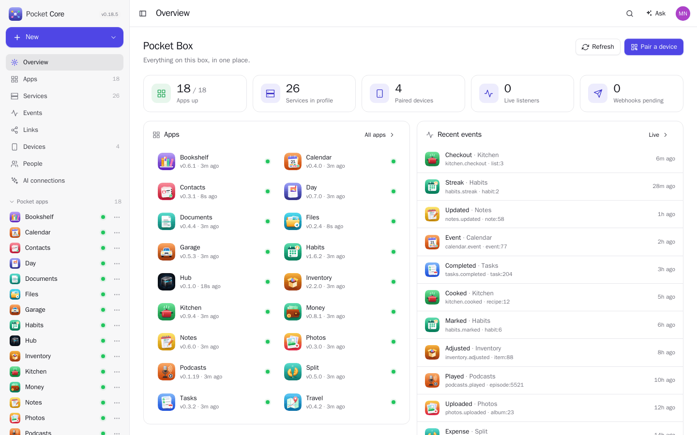
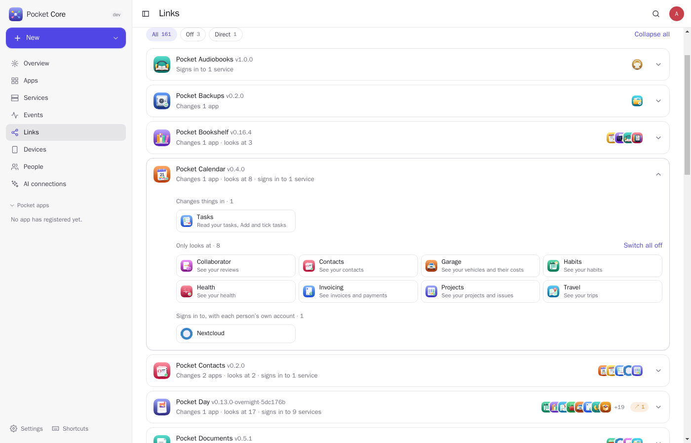
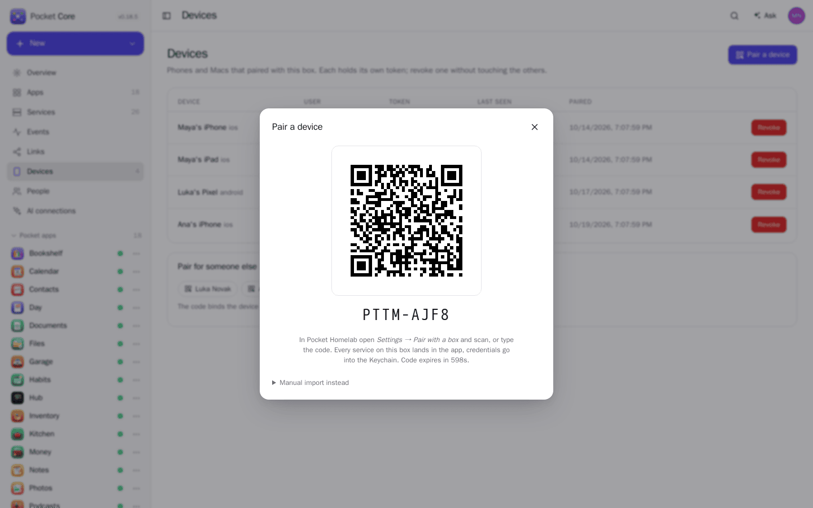
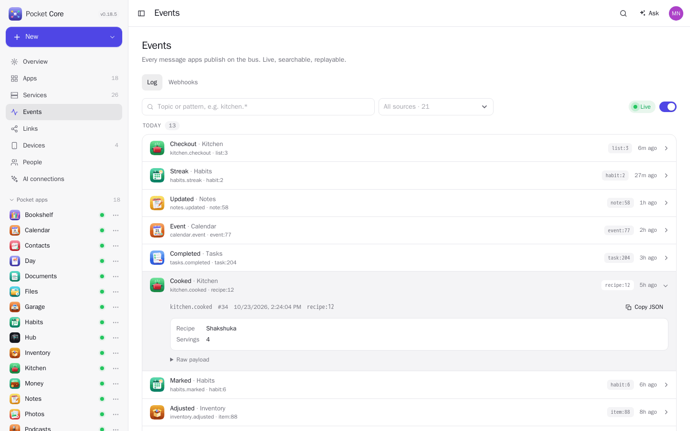
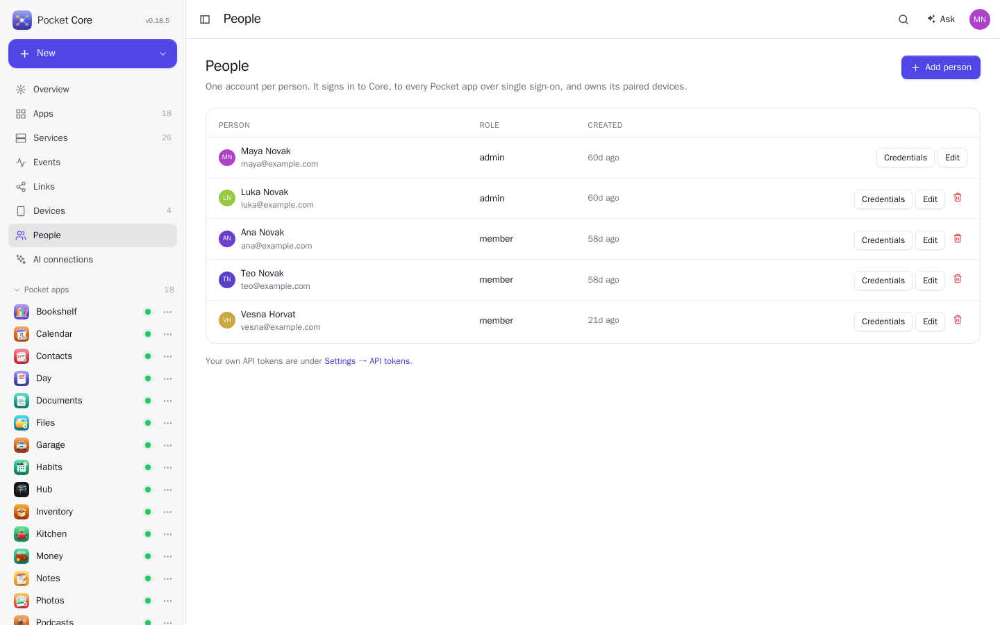
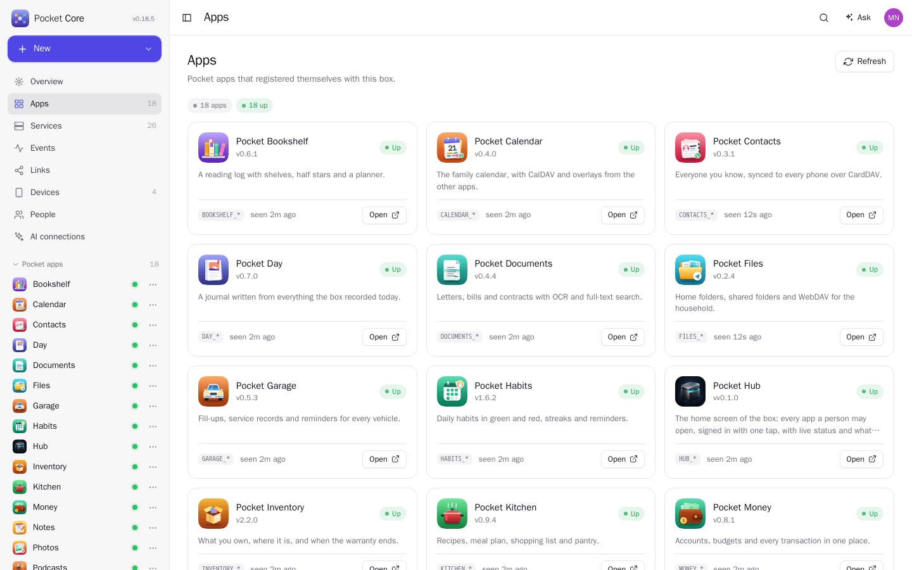
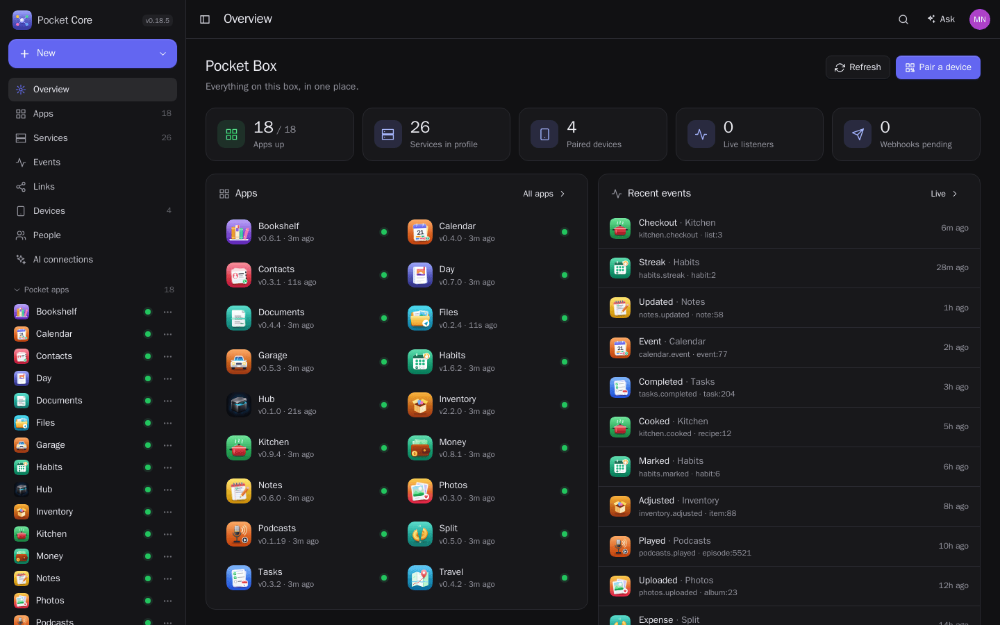
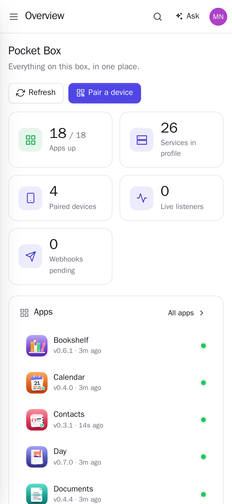
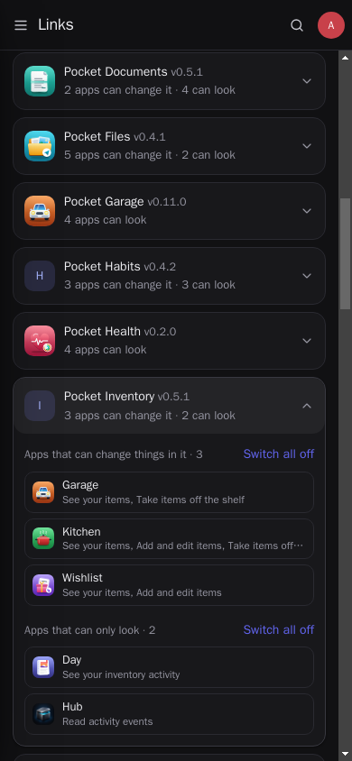
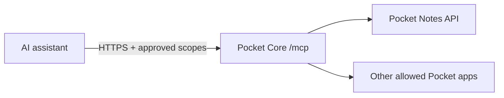

<p align="center">
  
</p>
<h1 align="center">Pocket Core</h1>
<p align="center">
  The hub of a <b>Pocket Box</b>: the registry Pocket apps announce themselves to, the event bus between them, the OpenID Connect provider they all log in with, and the pairing service that hands the <a href="https://pockethomelab.com">Pocket Homelab</a> app every service on the box in one QR code.<br>
  <b>One binary · one SQLite file · one volume.</b>
</p>
<p align="center">
  <a href="https://github.com/abjelosevic88/pocket-homelab-core/actions"></a>
  <a href="https://github.com/abjelosevic88/pocket-homelab-core/pkgs/container/pocket-homelab-core"></a>
  <a href="LICENSE"></a>
</p>

---

Every Pocket app is a small Go server with its own SQLite file. They already talk to each other: Kitchen keeps its pantry in Inventory, posts receipts to Split and marks a Habits habit. Until now that meant an `INVENTORY_URL` and an `INVENTORY_TOKEN` in every app's environment, an API key copied from six admin pages into the phone, and a separate login everywhere. Pocket Core is the piece in the middle that makes all of that one thing:

- **A registry.** An app starts, POSTs its manifest, and is known: name, icon, version, where it lives, what it publishes, what it wants to hear. Core polls its health and tells the others where it is (`GET /resolve?slug=habits`). No more `*_URL` variables.
- **An event bus.** `POST /events` with a topic and a payload. Core stores it, streams it to live listeners over Server-Sent Events (with replay after a reconnect) and POSTs it to webhooks with HMAC signatures and retries. “Cooked it” in Kitchen reaches Habits, Day and n8n without Kitchen knowing any of them exist.
- **Single sign-on.** Core is an OpenID Connect provider: one account per person signs in to every Pocket app and to Immich, Nextcloud, Paperless, Jellyfin or Audiobookshelf on the same box. Pocket apps get their client just by asking in the manifest.
- **Pairing.** Tap *Pair a device*, scan the QR with Pocket Homelab, done: the phone receives every service on the box with its own token, in exactly the env-file shape the client already imports. Revoke the device later and the token dies everywhere at once. Where someone has both apps for the same thing (Pocket Money and Firefly III, Pocket Music and Navidrome, Pocket Watch and Jellyfin…), *Devices → Apps on your devices* says which one their devices use.
- **A service catalog** mirroring the client's 44 integrations. Add Jellyfin with its API key once; every paired device gets `JELLYFIN_URL` and `JELLYFIN_API_KEY`. Secrets are encrypted at rest.
- **A household, not a user.** Admins and members. Each service says who receives it, so the NAS key never lands on a kid's phone, and every person can carry their own Jellyfin or Navidrome login while the rest stays shared. Members see their devices and their logins, nothing else.
- **Connectors.** Core can make each person's account in a third-party app and hand them their own key, switch on “Sign in with Pocket Core” there, and turn what happens in it into events. Audiobookshelf, Forgejo, Immich, Jellyfin, Jellyseerr, Kavita, Nextcloud and Paperless-ngx so far, plus events from Radarr, Sonarr, Lidarr, Prowlarr, Chaptarr, Komodo, Backrest, Beszel, Scrutiny, Speedtest Tracker, Changedetection.io, Uptime Kuma, Dawarich and Maloja; off until you switch them on.
- **App links.** One app can act for a person in another with no tokens pasted between them. Garage books a fill-up as a Money transaction, for every person on the box. The app asks for it in its manifest (`uses`) and the target says what it allows (`offers`). Core issues a five-minute token scoped to that one app and person, with a switch for the admin and one for each person.
- **Device tokens apps can trust.** A phone calls Pocket Habits with the token Core gave it; Habits asks Core “is this real?” (`/auth/introspect`) instead of keeping its own user list. The Go SDK does this in one middleware.
- **MCP for AI assistants.** An optional `/mcp` endpoint lets an authorized assistant discover Pocket apps, check health, and use curated application tools. People sign in with their Core account and approve status checks, reading content, or creating/updating items in their permitted apps. Operators can also issue named, expiring credentials. Credentials, personal content and administrative actions are excluded from these status tools.

Core runs on your box, next to the apps. You choose which service endpoints, identity providers and webhooks it contacts, and whether to make its authenticated MCP endpoint reachable remotely.

<p align="center"></p>

<table>
  <tr>
    <td width="50%"></td>
    <td width="50%"></td>
  </tr>
  <tr>
    <td align="center"><sub>App links: what each app may change, look at or sign in to, a switch behind every link.</sub></td>
    <td align="center"><sub>Pair a phone with one QR code; it receives every service on the box.</sub></td>
  </tr>
  <tr>
    <td width="50%"></td>
    <td width="50%"></td>
  </tr>
  <tr>
    <td align="center"><sub>Every event on the bus, live, filterable and replayable.</sub></td>
    <td align="center"><sub>One account per person, signed in to every app on the box.</sub></td>
  </tr>
  <tr>
    <td width="50%"></td>
    <td width="50%"></td>
  </tr>
  <tr>
    <td align="center"><sub>Apps register themselves on start; Core checks their health.</sub></td>
    <td align="center"><sub>Dark mode.</sub></td>
  </tr>
</table>

<p align="center">
  &nbsp;&nbsp;
  
</p>

## Run it

```sh
docker run -d --name pocket-core -p 8080:8080 -v ./data:/data \
  -e BASE_URL=https://core.example.com -e SECURE_COOKIES=true \
  ghcr.io/abjelosevic88/pocket-homelab-core:latest
```

or `docker compose up -d` with the included `docker-compose.yml`, or the single binary from the releases page, or `nix run ./deploy/nix`. Open it, create the admin account, and:

1. **Settings** shows the *registration key*. Give every Pocket app `CORE_URL=https://core.example.com` and `CORE_REGISTRATION_KEY=…`; they appear under **Apps** on their next start.
2. **Services → Add service** for the rest of the box: Jellyfin, Immich, Nextcloud… with their credentials.
3. **Pair a device**, scan, open Pocket Homelab. Everything is there.

`BASE_URL` matters: it is baked into pairing codes and is the OIDC issuer. Set it to the address phones and apps really use before pairing anything. Serving Core over plain http on the LAN? Use `SECURE_COOKIES=false`, or the browser drops the sign-in.

New box, or sign-in not working? Follow [docs/getting-started.md](docs/getting-started.md): install, connect apps, add people, and a troubleshooting table.

## Connect an AI assistant with MCP

Core includes an **account-based MCP gateway** using Streamable HTTP, with status checks and application-specific read/create/update tools.
One connection gives an assistant access to the registered Pocket apps you allow.
Ask “Who am I in Pocket?” to call `pocket_whoami`, which identifies the Core account
that approved the connection. Then ask for your data, such as “Show my open tasks”
or “Summarize my spending this month.” App tools use that account's identity and
permissions; they do not use an administrator's account.
The endpoint is disabled until configured. Build this checkout to use the feature;
an older release or an existing `latest` image may not include it.



| Tool | Use | Example arguments |
|---|---|---|
| `pocket_whoami` | Your signed-in Core account and connection permissions (account connections only) | `{}` |
| `pocket_core_status` | Core uptime, version and database readiness | `{}` |
| `pocket_list_apps` | Allowed apps and their cached health, including freshness | `{}` |
| `pocket_app_status` | Check one app; `fresh: true` probes it now | `{"slug":"notes","fresh":true}` |

Every app result includes observation/check timestamps and a freshness flag.
Old or missing cached checks are reported as `unknown`. A successful health check
means the service's health endpoint responded successfully; it does not prove
every feature is working. The initial tools cover registered Pocket apps.
Third-party connector administration, logs, deletion and service restarts are not exposed.
Application content tools require the separate opt-in and consent described below.

### Connect using your Core account (recommended)

The Core administrator enables account connections once:

```dotenv
BASE_URL=https://core.example.com
AUTH_MODE=local
SECURE_COOKIES=true
MCP_OAUTH_ENABLED=true
# Enable application content and read/create/update tools:
MCP_APP_TOOLS_ENABLED=true
```

Rebuild and restart Core with these settings. Existing Core password login or
upstream SSO works. Publish Core at that HTTPS URL, including its login,
`/mcp/oauth/*` and `/.well-known/*` routes. A proxy login wall must not intercept
MCP discovery, registration or token requests. With the repository Compose file,
put these settings in `.env` and deploy an image built from this source.

**The person connecting only needs the URL and a Core account.** No SSH access,
server configuration, copied API key or custom sign-in programming is required.

#### First-time setup on someone else's PC

Pocket is not preconfigured in Claude Code or Codex. Each person adds the Core
server to their own assistant, then signs in with their own Core account.

1. **The Core administrator gives the person an account.** For local accounts,
   use **People → Add person**, then set the apps they can access under
   **Services → Audience**. Existing Core accounts or configured SSO can be used.
2. **Share `https://core.example.com/connect`**, replacing the hostname with your
   actual Core URL. The person opens it and signs in with their own Core account.
   Being on the same Tailscale tailnet provides network access only; it does not
   create a Core account or grant application permissions. If Core is private,
   both their browser and the machine running their assistant must be able to
   reach that HTTPS URL through the tailnet.
3. **On their own PC, they need Claude Code or Codex installed and working.** On
   the **AI connections** page, choose the client and requested access, then click
   **Copy setup commands**. Run the commands in that PC's terminal. If the
   assistant runs on a remote machine, run them in that machine's terminal instead.
4. **Run the add command, then the login command**, shown below. The first saves
   a connection named `pocket` pointing to your Core MCP URL in that assistant's
   configuration. The second authenticates it. Adding the URL alone grants no
   access and does not create a Core account.

`pocket` is just a local connection name, not a built-in service, username or
cloud account. You can choose another name if you use it in both commands.
Claude's `--scope user` saves the configuration for the current operating-system
user across projects; the `oauth.scopes` values describe the access requested
from Core. Each person and each assistant installation needs its own setup.
No downloaded helper, Python installation, or manually managed token is required.

For Claude Code:

```sh
claude mcp add-json --scope user pocket '{"type":"http","url":"https://core.example.com/mcp","oauth":{"scopes":"status:read apps:read apps:write"}}'
claude mcp login pocket --no-browser
```

For Codex:

```sh
codex mcp add pocket --url https://core.example.com/mcp
codex mcp login pocket --no-browser --scopes status:read,apps:read,apps:write
```

5. **Open the authorization link printed by the terminal** on any computer or
   phone that can reach Core. Sign in as yourself, review access, and choose
   **Approve and copy sign-in response**.
6. **Click Copy sign-in response on Core's completion page.** Paste that response
   into the original terminal's waiting prompt and press Enter. It starts with
   `http://localhost:…/callback?code=…`; copy it as text, do not open it in the
   browser. Do not paste the original authorization link back into the terminal.
   The assistant exchanges the code with Core over HTTPS and saves its credentials
   on the machine where it runs. The browser can be on a different machine.
7. **Start a new assistant session** and ask: “Who am I in Pocket? Use
   `pocket_whoami`.” Check that it identifies your own Core account. Then ask
   “Show my open tasks” or “Check the status of all applications I can access.”

Already added `pocket` with the same access? Run only the login command when you
need to sign in again. If it reports that `pocket` is unknown, run the add command
first. Use a current client version supporting `--no-browser`.

Connections follow the user's app permissions, last up to 30 days, and can be
revoked in Core. See [native terminal setup](docs/mcp-apps.md#connect-claude-code-or-codex-recommended)
for read-only access, existing connections, and troubleshooting.

For clients needing a manually managed token, use **Core → AI connections →
Advanced: manual tokens and other clients → Create a token manually**. Choose the
access level and expiry, click **Create token with this access**, and copy the
token shown once. It uses your account's permissions and can be disconnected there.

Set `POCKET_ACCOUNT_MCP_TOKEN` in the environment/secret manager of the machine
running Codex, then add the connection:

```sh
codex mcp add pocket_account --url https://core.example.com/mcp \
  --bearer-token-env-var POCKET_ACCOUNT_MCP_TOKEN
```

Start a new Codex session with that variable available. **Do not run `codex mcp
login` for token mode**; no OAuth callback is needed. If replacing an existing
OAuth entry, update it to the URL and bearer environment variable above. Do not
put the token in chat, a repository, or the URL. Tokens expire after 1, 7 or 30
days and must then be replaced. Other clients can use an `Authorization: Bearer`
header if they support manual credentials. See [token setup](docs/mcp-apps.md#connect-without-a-localhost-redirect).

For browser OAuth sign-in, with the browser able to reach Codex's callback:


```sh
codex mcp add pocket_account --url https://core.example.com/mcp
codex mcp login pocket_account --scopes status:read,apps:read,apps:write
```

Complete the browser login and choose **Allow application access**. Start a new Codex
session and ask: “Find my grocery task list and add oat milk.” Do not set
`bearer_token_env_var` on this OAuth connection. Codex manages the access and
refresh tokens. See the [official Codex MCP documentation](https://developers.openai.com/codex/mcp/).

For Claude, add a custom remote connector with the same `/mcp` URL, choose sign-in,
and approve using your Core account. The connector feature must be available in
your client/workspace; see [Claude's remote connector guide](https://support.claude.com/en/articles/11175166-get-started-with-custom-connectors-using-remote-mcp).
Other clients need Streamable HTTP and OAuth discovery with dynamic registration;
a cloud client needs network access to the public HTTPS URL.

Open **Core → AI connections** to copy the endpoint, see connections, or disconnect
one. Connections last up to 30 days; access tokens last 15 minutes and refresh
automatically in supporting clients. Reconnect when the connection expires.
Disabling the account, changing its authentication revision, or disconnecting
revokes access. App sharing and enabled state are checked on every request, so
newly permitted apps appear automatically and removed permissions stop applying.
Only registered Pocket apps with an enabled service shared with that person are
included. A single connection covers all of them without individual MCP servers.

### Application tools and examples

The gateway includes curated tools for all 22 current Pocket applications. Your
assistant discovers only tools for apps shared with you and scopes you approved.
Applications still enforce their own item, calendar, file-space and group permissions.

| Scope | Allows |
|---|---|
| `status:read` | The three health/discovery tools above |
| `status:read apps:read` | Also read application content |
| `status:read apps:read apps:write` | Also create/update supported items |

Deletion, service administration, credential management, sharing changes and
sending messages are excluded. Existing status-only connections and operator
keys stay status-only. To upgrade a Codex connection, run `codex mcp logout
pocket_account`, then the login command above and approve the new scopes.
Other assistants must request these scopes through OAuth; approving only
`status:read` will show status tools and your own account identity, without application content tools.

Example requests after connecting:

- “Find my Notes about the renovation and summarize the open questions.”
- “Create a note called Weekend plan with these three ideas.”
- “List my calendars, then add a 30-minute planning event tomorrow at 09:00 in my timezone.”
- “Show low-stock inventory and add the missing ingredients to my Kitchen shopping list.”
- “Record a 12.50 EUR expense in my selected Money account.”
- “Show the tasks in this Collaborator review and mark this one done.”

For example, `pocket_notes_create` accepts:

```json
{
  "request_id": "bfbdc908-8bb0-4d54-8258-084defa36928",
  "data": {"title": "Weekend plan", "content": "- Buy ingredients\n- Plan the trip"}
}
```

Every change needs a new unique `request_id` (a UUID works). Retry the *identical*
change with the same ID to avoid duplicates. If a result is uncertain, read the
application before trying again with a different ID. Tool descriptions and schemas
explain required fields, units and update behavior. See the [application coverage
and extension guide](docs/mcp-apps.md) for every app and current limitations.

### Quick example: Pocket Notes

Requirements: Go 1.26+, Python 3, and a running Pocket Notes instance. From the
repository root:

```sh
python3 scripts/mcp-notes-demo.py --notes-url http://127.0.0.1:8182
```

Replace the Notes URL with yours. The script builds Core, starts an isolated
preview at `http://127.0.0.1:8190/mcp`, and registers Notes in a temporary database.
It prints a `source /tmp/.../client.env` command and the client configuration.
Keep the preview running, load that environment file in a second terminal, and
follow the Codex instructions below. Ctrl-C stops the preview and deletes its
temporary database and credential. Your existing Core and Notes deployments are
not modified.

### Alternative: operator-issued credentials

Build the binary and generate a client credential. This command does not open or
modify Core's database:

```sh
make all
./pocket-core mcp setup -apps notes,tasks -name codex \
  -url https://core.example.com/mcp
```

Use your actual Core hostname and registered app slugs. For a local-only client,
use `-url http://127.0.0.1:8080/mcp`. The setup command creates a new private
`mcp-secrets/` directory and refuses to overwrite an existing one:

| Generated file | Purpose |
|---|---|
| `mcp-secrets/server/clients.json` | Client name, token hash, allowed apps and expiry; Core reads this |
| `mcp-secrets/client.env` | Actual token for the assistant; keep private |
| `mcp-secrets/codex.toml` | Ready-to-copy Codex connection configuration |

Generated tokens expire after 90 days; use `-ttl 720h` for 30 days. The directory
is excluded from Git and Docker build contexts. Keep custom credential directories
outside the repository. Core needs only the `server/` directory.

For a native deployment, set this in your service's environment and restart Core
using your existing data directory and other settings:

```dotenv
MCP_CLIENTS_FILE=/absolute/path/to/mcp-secrets/server/clients.json
```

For the repository's Docker Compose deployment:

```sh
docker compose -f docker-compose.yml -f docker-compose.mcp.yml up -d --build
```

The override builds this source and mounts only `mcp-secrets/server/` read-only.
The container runs as UID 1000: ensure that UID can traverse the server directory
and read `clients.json`, while keeping their permissions private. If you run Core
from a different Compose project, apply the same environment variable and mount
there, preserving its existing data volume. App URLs in the registry must be
reachable **from Core**; inside Docker, `127.0.0.1` points to the Core container.

### Connect Codex with an operator credential and verify

On the computer running the MCP client, securely place `client.env` and load it:

```sh
source ./mcp-secrets/client.env
```

Copy the generated `codex.toml` entry into `~/.codex/config.toml`. For example:

```toml
[mcp_servers.pocket_status]
url = "https://core.example.com/mcp"
bearer_token_env_var = "POCKET_MCP_TOKEN"
```

Launch `codex` from that shell so it inherits the token. For the temporary Notes
demo, use its printed token-file path and `http://127.0.0.1:8190/mcp` URL instead.
An already running desktop app does not inherit a new shell's environment.
See the [official Codex MCP documentation](https://developers.openai.com/codex/mcp/).
Other MCP clients need Streamable HTTP and an `Authorization: Bearer …` header.

You can verify the connection without an LLM using Core's MCP client command:

```sh
./pocket-core mcp check -url https://core.example.com/mcp
./pocket-core mcp check -url https://core.example.com/mcp -app notes
```

The first command lists allowed apps; the second makes a fresh Notes probe.
`POCKET_MCP_TOKEN` must be present in that shell. Example result (timestamps and
version vary):

```json
{
  "slug": "notes",
  "name": "Pocket Notes",
  "version": "0.5.0",
  "status": "ok",
  "checked_at": "2026-10-21T14:12:34Z",
  "observed_at": "2026-10-21T14:12:34Z",
  "source": "live_health_probe",
  "stale": false,
  "http_status": 200
}
```

Example prompts:

- “Check Pocket Notes now and tell me when it was checked.”
- “List the Pocket apps I can inspect. Which results are stale?”
- “Check Core, then run fresh checks for any apps whose cached status is unknown.”

### Remote access, rotation and limits

An assistant can use this endpoint without SSH, Docker or filesystem access to
the device. Account connections need the URL and a Core account; operator connections
need the URL and their issued credential. Expose Core through HTTPS
using your reverse proxy or an outbound tunnel when the device is behind NAT.
Core and the device must remain online; a cloud-hosted client must be able to
reach the endpoint. A private VPN works when the client can access that VPN.

For operator-issued credentials, use one credential per client. The client file is reloaded on every request:
remove an entry to revoke it, change `apps` to narrow access, or replace its hash
and expiry to rotate it. Save changes with an atomic file replacement. Requests
already authorized may finish; subsequent requests use the new grants. `[]`
revokes every named client. Missing or invalid files fail closed. See the
[MCP guide](docs/mcp.md#manage-client-credentials) for adding and rotating clients.

All authenticated clients can read Core's basic process/database status. App
allowlists on operator-issued credentials grant visibility independently of household accounts;
give these credentials only to clients that should have that visibility.
The server limits aggregate MCP traffic to 120 requests/minute with a burst of
20, four concurrent requests, and 64 KiB request bodies. Live probes have a
six-second deadline. HTTP 429 includes `Retry-After`. Client IDs and tool outcomes
appear in Core's logs; tokens and raw upstream responses do not.

Account connections use a separate OAuth authorization server with explicit scopes,
consent, S256 PKCE, resource binding and rotating refresh tokens.
These tokens cannot access Core's ordinary API or its first-party OIDC apps.
The [full MCP guide](docs/mcp.md) covers both authentication modes, reverse-proxy
configuration, troubleshooting and the current scope.

## For app authors

```go
core := sdk.New(os.Getenv("CORE_URL"), sdk.Options{DB: db, TokenFile: dataDir + "/core.token"})
if err := core.Start(ctx); err != nil { return err } // ctx is cancelled at shutdown
reg, _ := core.Register(ctx, os.Getenv("CORE_REGISTRATION_KEY"), sdk.Manifest{
    Slug: "kitchen", Name: "Pocket Kitchen", URL: "http://pocket-kitchen:8080", PublicURL: baseURL, Version: version,
    Publishes:  []string{"kitchen.cooked", "kitchen.checkout"},
    Uses: []sdk.Use{{App: "inventory", Scopes: []string{"events:read"}}},
    Subscribes: []sdk.Subscription{{Topics: "inventory.*", URL: "/api/v1/core/events", Secret: hookSecret}},
    OIDC:       &sdk.OIDCRequest{RedirectURIs: []string{baseURL + "/auth/oidc/callback"}},
})
r.Use(core.Middleware)                                    // accept pcd_/pcu_/pco_ tokens from paired devices
_ = core.Publish(ctx, "kitchen.cooked", "recipe:12", map[string]any{"recipe": "Pancakes"})
habits, _ := core.Resolve(ctx, "habits")                  // habits.URL
```

Every call is a no-op error when `CORE_URL` is empty, so the same binary runs on a lab that has no Core. Manifest format, response and the introspection contract: [docs/manifest.md](docs/manifest.md).

## Security notes

Core holds every credential on the box, so a few choices are deliberate:

- Service credentials are AES-GCM encrypted with `DATA_DIR/secret.key`; every token Core issues is stored as a SHA-256 hash. Back up the key with the database and keep `DATA_DIR` at mode 0700. Point `SECRET_PATH` somewhere else if you want the key on different storage.
- Sign-in, pairing claims and app registration lock an IP (and, for sign-in, the account) for 15 minutes after 10 failures. Pairing codes are single-use and expire in 10 minutes.
- Session cookies are `HttpOnly`, `SameSite=Lax`, `Secure` behind HTTPS, and state-changing cookie requests must come from Core's own origin. Bearer tokens are exempt because a cross-site form cannot attach one.
- There is no consent screen: one box, one household. Do not point strangers' relying parties at it.
- Core is meant to sit on a LAN or tailnet. If you expose it to the internet, put it behind HTTPS and keep `BASE_URL` on that name.

Report anything you find privately before opening an issue.

## Docs

| | |
|---|---|
| [docs/getting-started.md](docs/getting-started.md) | first install step by step: address, admin, connecting apps, people, pairing; why sign-in fails |
| [docs/configuration.md](docs/configuration.md) | every environment variable, auth modes, token prefixes, CLI, what to back up |
| [docs/manifest.md](docs/manifest.md) | how an app registers; the Go SDK |
| [docs/platform-contract.md](docs/platform-contract.md) | upgrade order, permissions, identity, retries, validation and remaining delivery boundaries |
| [docs/events.md](docs/events.md) | publishing, SSE, webhooks and signatures |
| [docs/pairing.md](docs/pairing.md) | the QR flow and the profile format |
| [docs/oidc.md](docs/oidc.md) | endpoints, claims, relying-party recipes |
| [docs/links.md](docs/links.md) | App links: one Pocket app acting for a person in another (`uses` / `offers`, `pcx_` tokens, per-person switches) |
| [docs/connectors.md](docs/connectors.md) | Core acting on third-party apps: accounts, sign-in, events (Immich first); how to write one |
| [docs/api.md](docs/api.md) | the whole REST surface |
| [docs/mcp-apps.md](docs/mcp-apps.md) | Application tools, permissions, examples and adding adapters |
| [docs/mcp.md](docs/mcp.md) | MCP authentication, status gateway and remote access design |
| [docs/spec.md](docs/spec.md) | the versioned contract: tokens, manifest, events, profile, OIDC |
| [deploy/nix](deploy/nix) | Nix package and `services.pocket.core` NixOS module |
| [docs/roadmap.md](docs/roadmap.md) | where the box is going |

## Develop

```sh
make dev     # API on :8080 with demo data and no login, Vite on :5173
make test    # go vet + go test (includes an end-to-end test of register → publish → pair → OIDC) + tsc
make all     # web + binary with the UI embedded
```

Go 1.26, React 19, chi, modernc SQLite (no cgo), the official MCP Go SDK and a pure-Go QR encoder.

## License

MIT.
