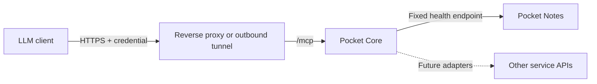

# MCP gateway

Core provides an opt-in MCP endpoint at `/mcp`, using the official Go SDK and
Streamable HTTP. Status tools cover Core and registered Pocket apps. Optional
[application tools](mcp-apps.md) add account-scoped reading and creating/updating
items across all current Pocket apps. Deletion, service administration and logs
are not exposed. Operator credentials remain status-only.

## Terminal pairing

[Pocket Connect](mcp-apps.md#pair-from-a-terminal-recommended) provides a public-URL
approval flow for Codex CLI and Claude Code. Download `/mcp/connect.py`, run it on
the assistant's machine, open its link, enter the terminal code, approve, and
paste the completion code back. The helper configures MCP and checks tool
discovery without a localhost callback. It needs Python 3.11+, not server access.

This is a Core-specific pairing protocol, separate from OAuth discovery. All
routes require `MCP_OAUTH_ENABLED`; content scopes require `MCP_APP_TOOLS_ENABLED`.
`POST /mcp/pair/start` accepts a name, scope and expiry; it returns a terminal-only
request secret, human pairing code, verification URL and 600-second lifetime.
Browser `POST /mcp/pair/inspect`, `/approve`, and `/deny` require a Core session and
exact same Origin. Approval binds the request to that user's authentication
revision and returns a one-use completion code. `POST /mcp/pair/exchange` requires
both that completion code and the original terminal secret. It atomically consumes
the request and creates an ordinary scoped MCP connection token; approval alone
does not create a credential. Account changes, disabled scopes, expiry, denial,
or previous redemption prevent issuance. Nothing redirects to the terminal.

All three pairing secrets are stored as hashes. Responses are not cacheable,
request bodies are capped at 4 KiB, and endpoints have independent rate limits
(start: one per five seconds, burst 10; others: one per second, burst 20).
At most 1,000 live pairing requests are retained. Expired requests are removed on
creation and by the janitor. Credentials share the existing 20-active-token
account limit, 1/7/30-day lifetimes and disconnect semantics. Core never returns
the MCP credential to the browser in this flow. The helper refuses HTTP except
for loopback, never follows HTTP redirects, and saves credentials only in the
assistant's private config. An unredeemed approval expires with its request.

## Connection tokens for remote assistants

Account users can create scoped, expiring tokens under **AI connections → Connect
without redirects**. This avoids a localhost callback when the browser and
assistant run on different machines. See the [no-redirect setup guide](mcp-apps.md#connect-without-a-localhost-redirect).
Tokens require `MCP_OAUTH_ENABLED=true`; content scopes additionally require
`MCP_APP_TOOLS_ENABLED=true`. They are separate from operator status keys and
ordinary personal API tokens. Creation requires an authenticated browser session,
an exact same-origin request, and explicit scope approval. The raw token is returned
once with `Cache-Control: no-store`; only its hash is stored. Per-account limits
and expiry bound active tokens, and orphan private client records are removed
when disconnected or expired. No callback or refresh credential is issued.

## Account sign-in

Enable `MCP_OAUTH_ENABLED=true`, `AUTH_MODE=local`, and an HTTPS origin in
`BASE_URL` (HTTP loopback is allowed for local development). Use secure cookies
on HTTPS. Existing password or upstream SSO login is reused. This mode can run
alongside either operator credential mode below; no token file is required.

```sh
codex mcp add pocket_account --url https://core.example.com/mcp
codex mcp login pocket_account
```

In the browser, sign in to Core and approve **Allow status access**. For Claude's
custom remote connector, supply the same URL and choose sign-in. A person needs
only their Core account and URL. Their assistant receives the `status:read`
scope, covering Core availability and the registered Pocket apps whose enabled
service audience includes that person. Apps without a mirrored service are
excluded. The app list is recomputed on every HTTP request. Operator app
allowlists do not constrain account connections; Core's service sharing does.

**Core → AI connections** (`/ai-connections`) shows connections and a disconnect
button. Every user can manage only their own connections. Access tokens last
15 minutes; rotating refresh tokens cannot extend the 30-day connection lifetime.
Reusing a consumed code or refresh token revokes its connection. Revocation and
account disable/authentication-revision changes take effect on the next request;
already authorized requests may finish. Logging out of the browser alone does
not disconnect an assistant. Revoked or expired clients must sign in again.

Core publishes protected resource metadata at
`/.well-known/oauth-protected-resource/mcp`, and authorization-server metadata at
`/.well-known/oauth-authorization-server/mcp/oauth`. The issuer is
`BASE_URL/mcp/oauth`. Endpoints under it are `/register`, `/authorize`, `/token`
and `/revoke`. Registration supports public clients and client-secret basic/post
authentication, exact HTTPS or literal-loopback HTTP callbacks, authorization
code flow with mandatory S256 PKCE, and refresh rotation. Requests must target
the exact `BASE_URL/mcp` resource. `status:read` is always supported; enabling
`MCP_APP_TOOLS_ENABLED=true` additionally advertises `apps:read` and `apps:write`.
Content scopes require `status:read`, and write also requires read. Scope changes
require fresh consent; refresh cannot expand access. Dynamic client
registration is supported; Client ID Metadata Documents are not implemented.

OAuth clients, grants and hashed credentials are stored separately from Core's
first-party OIDC clients and API tokens. Registration does not grant access until
a signed-in person approves. Client names are supplied by the connecting app;
the consent page also shows the callback address. Registration is limited to a
burst of 10 and one request per 10 seconds, with at most 1,000 registrations per
Core database. OAuth requests have a 16 KiB body limit and aggregate limit of
five per second, burst 30. Discovery does not require authentication.

Publish the existing Core web origin, including login, SSO callbacks, OAuth,
discovery and `/mcp` routes. Avoid a separate proxy authentication redirect on
machine-facing endpoints. The dedicated `/mcp`-only proxy example below applies
to operator-issued credentials, **not** account sign-in. Core does not provision
DNS, certificates or tunnels. Existing reverse proxies serving all Core routes
usually need no routing changes.

## Try Notes without changing the running Core

From this checkout, with Go and Python 3 installed and Notes running:

```sh
python3 scripts/mcp-notes-demo.py
```

The default Notes URL is `http://127.0.0.1:8182`; override with `--notes-url URL`.
The script builds Core, starts a separate instance on loopback port 8190, and
registers Notes in a temporary database. It prints the path to a private token
environment file and the Codex configuration. Keep this terminal running.
Use `--port 8191` if needed. No existing Core database or service is modified.

In a second terminal, run the printed `source /tmp/.../client.env` command. Add
this to `~/.codex/config.toml`, then launch `codex` **from that terminal**, so it
inherits the token:

```toml
[mcp_servers.pocket_status]
url = "http://127.0.0.1:8190/mcp"
bearer_token_env_var = "POCKET_MCP_TOKEN"
```

Ask: “Check Pocket Notes with a fresh health probe. Tell me when it was checked.”
Or: “List the apps I can inspect and flag stale or unhealthy results.”
An already running desktop application does not inherit exports from a new shell.
See [Codex MCP configuration](https://developers.openai.com/codex/mcp/).

Ctrl-C stops the preview and deletes its temporary database and token file.
Each new preview generates a new token; source the newly printed file again.
Remove the config entry when finished, or replace its URL when deploying Core.

## Tools and guarantees

| Tool | Arguments | Result |
|---|---|---|
| `pocket_core_status` | `{}` | Core process uptime/version and database readiness |
| `pocket_list_apps` | `{}` | Allowed registered apps, cached health, timestamps and freshness |
| `pocket_app_status` | `{"slug":"notes","fresh":true}` | Live HTTP health check; omit `fresh` for cached status |

Cached checks older than twice `HEALTH_INTERVAL`, missing timestamps or future
timestamps return `status: unknown` and `stale: true`. Live checks use a six-second
deadline and report HTTP status plus a fixed diagnostic code. HTTP errors are
unhealthy, connection failures are unreachable, and unrecognized responses are
unknown. An HTTP 200 login page is not a healthy service. Version is the registry's
last known version, not a verified build identity from the live check.

A healthy result only establishes that the configured health endpoint responded
successfully; it does not verify every service feature. The gateway must be
online to return live results. This is request-driven inspection, not continuous
LLM monitoring or notifications.

Tools accept app slugs, never arbitrary URLs, commands or paths. Targets come from
Core's trusted registry. Fresh checks send no credentials, follow no redirects,
read at most 16 KiB of health JSON, and do not update the registry. Results omit
private URLs, manifests, raw errors, upstream response bodies and credentials.
Core logs the client ID, tool names, selected app, freshness and outcome. Client
IDs identify configured integrations; OAuth audit IDs also include the Core user ID.

## Enable in an existing Core deployment

Build/deploy this source revision first; older released images may not contain
this endpoint. For scripts or clients that use manually supplied bearer tokens,
use named, expiring clients:

```sh
make all
./pocket-core mcp setup -apps notes,tasks -name codex -url https://core.example.com/mcp
```

Configure Core with `MCP_CLIENTS_FILE=/absolute/path/to/mcp-secrets/server/clients.json`.
The setup command creates private files and refuses to overwrite an existing
directory. The token is in `mcp-secrets/client.env`; Core reads only its hash from
`server/clients.json`. The client expiry defaults to 90 days (`-ttl 720h` selects
30 days). Copy `mcp-secrets/codex.toml` into the client's configuration and load
`client.env` in the shell that launches the client.

For the repository's Compose deployment:

```sh
docker compose -f docker-compose.yml -f docker-compose.mcp.yml up -d --build
```

This builds the source and mounts the server credential directory. Ensure the
container's UID 1000 can read it. The actual token file is not mounted. For an
existing deployment elsewhere, preserve its data mount and add the environment
variable and server-directory mount to that deployment.

To verify authentication, MCP negotiation and a live tool call:

```sh
source ./mcp-secrets/client.env
./pocket-core mcp check -url https://core.example.com/mcp -app notes
```

Omit `-app` to list allowed apps. A successful command exits zero even if the
reported service is unhealthy: inspect the returned `status`. Authentication and
protocol failures exit nonzero. The CLI refuses plaintext HTTP to remote hosts
and never follows redirects with the token.

### Manage client credentials

The file is a JSON array. Each entry requires a unique client ID and SHA-256 token
hash, a nonempty app allowlist, and an RFC3339 expiry:

```json
[
  {
    "id": "codex",
    "token_hash": "<64-character SHA-256 hex digest>",
    "apps": ["notes", "tasks"],
    "expires_at": "2027-01-01T00:00:00Z"
  }
]
```

Use the setup command to generate real hashes; the placeholder above is not valid.
`["*"]` explicitly allows every current and future registered Pocket app. All
clients can see Core process/database readiness. These are operator-issued
status grants, not household-user sessions or person-specific domain grants.

To add another client, generate a second private directory with `mcp setup -dir
/path/outside/repository -name another-client -apps notes -url https://core.example.com/mcp`.
Append its generated entry to the active `clients.json` using an atomic file
replacement, and securely deliver only its `client.env` to that client. For
rotation, replace the corresponding entry using newly generated credentials
with the same ID. For revocation, remove the entry. An empty array revokes all
named clients. Expired credentials return 401. Existing in-flight calls may
finish; every subsequent HTTP request rechecks the current file and expiry.
No Core restart is needed for file edits. Enabling/disabling the file setting
itself requires a restart. A missing/malformed/oversized file returns 503 and
never falls back to a previously authorized snapshot.

Mount the directory, not only `clients.json`, in Docker: a file bind mount can
retain the old inode after atomic replacement. Do not configure `MCP_TOKEN_HASH`
and `MCP_CLIENTS_FILE` together; Core rejects that ambiguous configuration.

### Single environment credential (simple deployments)

The original environment-based setup remains available, including for the
isolated preview. Generate a separate random token and its SHA-256 digest:

```sh
export POCKET_MCP_TOKEN="$(openssl rand -hex 32)"
printf '%s' "$POCKET_MCP_TOKEN" | openssl dgst -sha256
```

Store the token in the client's secret environment. Configure Core with the
64-character hex digest and an explicit list of app slugs:

```dotenv
MCP_TOKEN_HASH=<hex digest only>
MCP_APPS=notes
```

Restart Core to apply. `MCP_APPS=notes,tasks,garage` allows those apps;
`MCP_APPS=*` deliberately allows all current and future registered Pocket apps.
With OAuth disabled and neither `MCP_TOKEN_HASH` nor `MCP_CLIENTS_FILE`, `/mcp`
returns HTTP 404. Operator credentials require a valid hash and nonempty allowlist. Browser sessions, registration keys, app tokens
and Core's `AUTH_MODE=none` never bypass MCP bearer authentication. The dedicated
MCP token is not a Core API/admin credential. Rotate/revoke by replacing/removing
the hash and restarting Core. The single environment credential has no automatic expiry; use the named-client file for expiring credentials.

To inspect tool discovery manually (legacy protocol remains supported by the SDK):

```sh
curl --fail-with-body http://127.0.0.1:8190/mcp \
  -H "Authorization: Bearer $POCKET_MCP_TOKEN" \
  -H 'Content-Type: application/json' \
  -H 'Accept: application/json, text/event-stream' \
  -H 'MCP-Protocol-Version: 2025-11-25' \
  --data '{"jsonrpc":"2.0","id":1,"method":"tools/list","params":{}}'
```

## Remote device access



The LLM client needs the MCP URL and credential; it does not need SSH, Docker or
filesystem access. The device still needs a reachable network path. For a device
behind NAT, an outbound tunnel can provide that path. A VPN works when the MCP
client itself can join that network; a cloud-hosted client generally needs an
externally reachable HTTPS endpoint or a supported private-network connector.
Public reachability and anonymous access are separate decisions.

For operator-issued credentials, use a client supporting an explicit bearer header. Publish only
the exact `/mcp` path through a TLS proxy/tunnel, preserve the Authorization
header, apply edge request/concurrency limits, and do not send MCP requests to an
interactive browser login redirect. Do not forward other Core routes from a
dedicated MCP hostname. The SDK's localhost Host protection remains enabled;
for a proxy connecting to loopback, set the upstream Host to the loopback target
(for example Caddy `header_up Host {upstream_hostport}`). Requests with an Origin
header must match the origin of Core's configured `BASE_URL`; non-browser clients
normally omit Origin. A separate browser-facing MCP origin needs explicit policy
support before use. Internet routing and TLS are not provisioned by this change.

Example Caddy configuration for a dedicated MCP hostname (adapt the upstream):

```caddyfile
mcp.example.com {
    handle /mcp {
        reverse_proxy 127.0.0.1:8080 {
            header_up Host {upstream_hostport}
        }
    }
    handle {
        respond "Not found" 404
    }
}
```

Caddy normally forwards the Authorization header. Configure DNS/TLS and point the
MCP client at `https://mcp.example.com/mcp`. This example does not expose Core's
other routes. Browser clients sending Origin must still match `BASE_URL` as
explained above; the CLI clients shown here omit that header.

Core enforces an aggregate rate of two MCP requests/second (120/minute), burst
20, and at most four simultaneous requests. Excess requests return 429 with
`Retry-After: 1`. Request bodies are capped at 64 KiB and body reads at 15 seconds.
Live health responses are capped at 16 KiB and must be a single JSON object. Add
edge limits too when exposing an internet endpoint.

For account-based access, enable the OAuth mode above. Other MCP clients must
support its discovery, registration and authorization-code flow; availability
and configuration vary by client. Application content and changes use the
separate opt-in, consent scopes and curated adapters in [Application tools](mcp-apps.md).

## Where this belongs in Core

Keep one endpoint and shared discovery/auth/audit in Core. Keep service-specific
adapters small and let each app own its domain API. Core now provides fleet status
and account-scoped application tools with explicit consent, request IDs and audit
receipts. Future connector health or activity tools need their own bounded,
per-person authorization policy; raw logs and device administration remain outside
this catalog.

Expose selected task-oriented operations, not automatic wrappers around every
admin endpoint. Service-owned MCP implementations can be added when independent
use is valuable; a Core adapter should enforce the same permission policy.

References: [MCP transports](https://modelcontextprotocol.io/specification/latest/basic/transports),
[MCP authorization](https://modelcontextprotocol.io/specification/latest/basic/authorization),
[official Go SDK](https://github.com/modelcontextprotocol/go-sdk).

## Verification

```sh
go test ./internal/server -run TestMCP -count=1
MCP_TEST_NOTES_URL=http://127.0.0.1:8182 go test ./internal/server -run TestMCPLiveNotes -v -count=1
make test
```

The integration test uses a temporary Core registry and the real MCP SDK client
to call the running Notes health endpoint; it does not change Notes or production Core.

## Troubleshooting

| Symptom | What to check |
|---|---|
| HTTP 404 | Build includes MCP, OAuth or an operator credential mode is enabled, and proxy forwards `/mcp` |
| HTTP 401 | `POCKET_MCP_TOKEN` is exported in the client process; token matches a current, unexpired entry |
| HTTP 403 | Origin matches `BASE_URL`; loopback proxy rewrites upstream Host as shown above |
| HTTP 429 | Honor Retry-After; reduce concurrent calls/polling frequency |
| HTTP 503 | Named client file is readable, valid, within 64 KiB, and contains unique IDs/hashes and expiries |
| Empty app list | Account: enabled services share registered apps with that user. Operator: app slugs appear in the credential allowlist |
| App unavailable | Slug is missing or not allowed; denied and nonexistent apps intentionally look the same |
| `unknown` / `stale: true` | Cached check missing/old; request `fresh: true` |
| `unreachable` | Core can reach the registered app URL from its own container/network |
| `unknown` from a live probe | Health endpoint returns recognized JSON, not a login page or redirect |
| Cannot use OAuth login | Enable `MCP_OAUTH_ENABLED`, use the canonical Core URL, forward discovery/OAuth routes, and remove manual bearer configuration from that client |
| OAuth `invalid_grant` | Connection expired/revoked, account changed, or code/refresh token reused; reconnect through browser sign-in |
