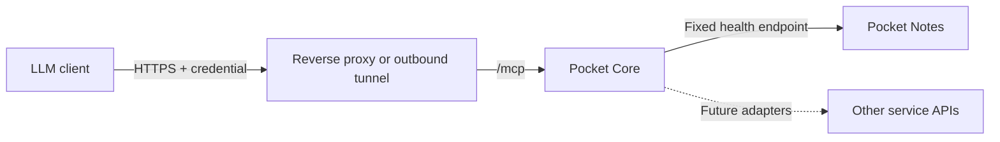

# MCP service status

Core provides an opt-in, read-only MCP endpoint at `/mcp`, using the official Go
SDK and Streamable HTTP. This first slice exposes Core health and registered
Pocket app health. Notes is the worked example. It does not yet expose third-party
connectors, activity/history, logs, domain content, or device administration.

## Try Notes without changing the running Core

From this checkout, with Go and Python 3 installed and Notes running:

```sh
python3 scripts/mcp-notes-demo.py
```

The default Notes URL is `http://127.0.0.1:8182`; override with `--notes-url URL`.
The script builds Core, starts a separate instance on loopback port 8190, and
registers Notes in a temporary database. It prints the path to a private token
environment file and the Codex configuration. Keep this terminal running.
Use `--port 8191` if needed. No existing Core database or service is modified.

In a second terminal, run the printed `source /tmp/.../client.env` command. Add
this to `~/.codex/config.toml`, then launch `codex` **from that terminal**, so it
inherits the token:

```toml
[mcp_servers.pocket_status]
url = "http://127.0.0.1:8190/mcp"
bearer_token_env_var = "POCKET_MCP_TOKEN"
```

Ask: “Check Pocket Notes with a fresh health probe. Tell me when it was checked.”
Or: “List the apps I can inspect and flag stale or unhealthy results.”
An already running desktop application does not inherit exports from a new shell.
See [Codex MCP configuration](https://developers.openai.com/codex/mcp/).

Ctrl-C stops the preview and deletes its temporary database and token file.
Each new preview generates a new token; source the newly printed file again.
Remove the config entry when finished, or replace its URL when deploying Core.

## Tools and guarantees

| Tool | Arguments | Result |
|---|---|---|
| `pocket_core_status` | `{}` | Core process uptime/version and database readiness |
| `pocket_list_apps` | `{}` | Allowed registered apps, cached health, timestamps and freshness |
| `pocket_app_status` | `{"slug":"notes","fresh":true}` | Live HTTP health check; omit `fresh` for cached status |

Cached checks older than twice `HEALTH_INTERVAL`, missing timestamps or future
timestamps return `status: unknown` and `stale: true`. Live checks use a six-second
deadline and report HTTP status plus a fixed diagnostic code. HTTP errors are
unhealthy, connection failures are unreachable, and unrecognized responses are
unknown. An HTTP 200 login page is not a healthy service. Version is the registry's
last known version, not a verified build identity from the live check.

A healthy result only establishes that the configured health endpoint responded
successfully; it does not verify every service feature. The gateway must be
online to return live results. This is request-driven inspection, not continuous
LLM monitoring or notifications.

Tools accept app slugs, never arbitrary URLs, commands or paths. Targets come from
Core's trusted registry. Fresh checks send no credentials, follow no redirects,
read at most 16 KiB of health JSON, and do not update the registry. Results omit
private URLs, manifests, raw errors, upstream response bodies and credentials.
Core logs the client ID, tool names, selected app, freshness and outcome. Client
IDs identify configured integrations, not authenticated household members.

## Enable in an existing Core deployment

Build/deploy this source revision first; older released images may not contain
this endpoint. The recommended setup uses named, expiring clients:

```sh
make all
./pocket-core mcp setup -apps notes,tasks -name codex -url https://core.example.com/mcp
```

Configure Core with `MCP_CLIENTS_FILE=/absolute/path/to/mcp-secrets/server/clients.json`.
The setup command creates private files and refuses to overwrite an existing
directory. The token is in `mcp-secrets/client.env`; Core reads only its hash from
`server/clients.json`. The client expiry defaults to 90 days (`-ttl 720h` selects
30 days). Copy `mcp-secrets/codex.toml` into the client's configuration and load
`client.env` in the shell that launches the client.

For the repository's Compose deployment:

```sh
docker compose -f docker-compose.yml -f docker-compose.mcp.yml up -d --build
```

This builds the source and mounts the server credential directory. Ensure the
container's UID 1000 can read it. The actual token file is not mounted. For an
existing deployment elsewhere, preserve its data mount and add the environment
variable and server-directory mount to that deployment.

To verify authentication, MCP negotiation and a live tool call:

```sh
source ./mcp-secrets/client.env
./pocket-core mcp check -url https://core.example.com/mcp -app notes
```

Omit `-app` to list allowed apps. A successful command exits zero even if the
reported service is unhealthy: inspect the returned `status`. Authentication and
protocol failures exit nonzero. The CLI refuses plaintext HTTP to remote hosts
and never follows redirects with the token.

### Manage client credentials

The file is a JSON array. Each entry requires a unique client ID and SHA-256 token
hash, a nonempty app allowlist, and an RFC3339 expiry:

```json
[
  {
    "id": "codex",
    "token_hash": "<64-character SHA-256 hex digest>",
    "apps": ["notes", "tasks"],
    "expires_at": "2027-01-01T00:00:00Z"
  }
]
```

Use the setup command to generate real hashes; the placeholder above is not valid.
`["*"]` explicitly allows every current and future registered Pocket app. All
clients can see Core process/database readiness. These are operator-issued
status grants, not household-user sessions or person-specific domain grants.

To add another client, generate a second private directory with `mcp setup -dir
/path/outside/repository -name another-client -apps notes -url https://core.example.com/mcp`.
Append its generated entry to the active `clients.json` using an atomic file
replacement, and securely deliver only its `client.env` to that client. For
rotation, replace the corresponding entry using newly generated credentials
with the same ID. For revocation, remove the entry. An empty array revokes all
named clients. Expired credentials return 401. Existing in-flight calls may
finish; every subsequent HTTP request rechecks the current file and expiry.
No Core restart is needed for file edits. Enabling/disabling the file setting
itself requires a restart. A missing/malformed/oversized file returns 503 and
never falls back to a previously authorized snapshot.

Mount the directory, not only `clients.json`, in Docker: a file bind mount can
retain the old inode after atomic replacement. Do not configure `MCP_TOKEN_HASH`
and `MCP_CLIENTS_FILE` together; Core rejects that ambiguous configuration.

### Single environment credential (simple deployments)

The original environment-based setup remains available, including for the
isolated preview. Generate a separate random token and its SHA-256 digest:

```sh
export POCKET_MCP_TOKEN="$(openssl rand -hex 32)"
printf '%s' "$POCKET_MCP_TOKEN" | openssl dgst -sha256
```

Store the token in the client's secret environment. Configure Core with the
64-character hex digest and an explicit list of app slugs:

```dotenv
MCP_TOKEN_HASH=<hex digest only>
MCP_APPS=notes
```

Restart Core to apply. `MCP_APPS=notes,tasks,garage` allows those apps;
`MCP_APPS=*` deliberately allows all current and future registered Pocket apps.
With neither `MCP_TOKEN_HASH` nor `MCP_CLIENTS_FILE`, `/mcp` returns HTTP 404. An enabled endpoint requires a
valid hash and nonempty allowlist. Browser sessions, registration keys, app tokens
and Core's `AUTH_MODE=none` never bypass MCP bearer authentication. The dedicated
MCP token is not a Core API/admin credential. Rotate/revoke by replacing/removing
the hash and restarting Core. The single environment credential has no automatic expiry; use the named-client file for expiring credentials.

To inspect tool discovery manually (legacy protocol remains supported by the SDK):

```sh
curl --fail-with-body http://127.0.0.1:8190/mcp \
  -H "Authorization: Bearer $POCKET_MCP_TOKEN" \
  -H 'Content-Type: application/json' \
  -H 'Accept: application/json, text/event-stream' \
  -H 'MCP-Protocol-Version: 2025-11-25' \
  --data '{"jsonrpc":"2.0","id":1,"method":"tools/list","params":{}}'
```

## Remote device access



The LLM client needs the MCP URL and credential; it does not need SSH, Docker or
filesystem access. The device still needs a reachable network path. For a device
behind NAT, an outbound tunnel can provide that path. A VPN works when the MCP
client itself can join that network; a cloud-hosted client generally needs an
externally reachable HTTPS endpoint or a supported private-network connector.
Public reachability and anonymous access are separate decisions.

Use a client supporting an explicit bearer header. Publish only
the exact `/mcp` path through a TLS proxy/tunnel, preserve the Authorization
header, apply edge request/concurrency limits, and do not send MCP requests to an
interactive browser login redirect. Do not forward other Core routes from a
dedicated MCP hostname. The SDK's localhost Host protection remains enabled;
for a proxy connecting to loopback, set the upstream Host to the loopback target
(for example Caddy `header_up Host {upstream_hostport}`). Requests with an Origin
header must match the origin of Core's configured `BASE_URL`; non-browser clients
normally omit Origin. A separate browser-facing MCP origin needs explicit policy
support before use. Internet routing and TLS are not provisioned by this change.

Example Caddy configuration for a dedicated MCP hostname (adapt the upstream):

```caddyfile
mcp.example.com {
    handle /mcp {
        reverse_proxy 127.0.0.1:8080 {
            header_up Host {upstream_hostport}
        }
    }
    handle {
        respond "Not found" 404
    }
}
```

Caddy normally forwards the Authorization header. Configure DNS/TLS and point the
MCP client at `https://mcp.example.com/mcp`. This example does not expose Core's
other routes. Browser clients sending Origin must still match `BASE_URL` as
explained above; the CLI clients shown here omit that header.

Core enforces an aggregate rate of two MCP requests/second (120/minute), burst
20, and at most four simultaneous requests. Excess requests return 429 with
`Retry-After: 1`. Request bodies are capped at 64 KiB and body reads at 15 seconds.
Live health responses are capped at 16 KiB and must be a single JSON object. Add
edge limits too when exposing an internet endpoint.

For a multi-user product, implement the MCP OAuth authorization profile, protected
resource metadata, consent, audience validation, per-user/tool/app scopes and
revocation. Core's existing OIDC login is a foundation, not automatically a
complete MCP authorization server. This implementation's manually provisioned bearer credentials
does not implement that OAuth discovery/login flow and is not a universal
one-click connector for every hosted assistant.

## Where this belongs in Core

Keep one endpoint and shared discovery/auth/audit in Core. Keep service-specific
adapters small and let each app own its domain API. Extend in this order:

1. Fleet status: registered app checks, then connector-specific health and queue
   summaries for services such as Sonarr, Jellyfin and backup/monitoring tools.
2. Activity: bounded, filtered events with per-person authorization and timestamps;
   never forward the whole event bus or raw logs by default.
3. Actions: separate scopes and tools, explicit approval for disruptive operations,
   idempotency keys and audit receipts. Reuse delegated app APIs where possible.

Expose selected task-oriented operations, not automatic wrappers around every
admin endpoint. Service-owned MCP implementations can be added when independent
use is valuable; a Core adapter should enforce the same permission policy.

References: [MCP transports](https://modelcontextprotocol.io/specification/latest/basic/transports),
[MCP authorization](https://modelcontextprotocol.io/specification/latest/basic/authorization),
[official Go SDK](https://github.com/modelcontextprotocol/go-sdk).

## Verification

```sh
go test ./internal/server -run TestMCP -count=1
MCP_TEST_NOTES_URL=http://127.0.0.1:8182 go test ./internal/server -run TestMCPLiveNotes -v -count=1
make test
```

The integration test uses a temporary Core registry and the real MCP SDK client
to call the running Notes health endpoint; it does not change Notes or production Core.

## Troubleshooting

| Symptom | What to check |
|---|---|
| HTTP 404 | Build includes MCP, one credential mode is enabled, and proxy forwards exact `/mcp` |
| HTTP 401 | `POCKET_MCP_TOKEN` is exported in the client process; token matches a current, unexpired entry |
| HTTP 403 | Origin matches `BASE_URL`; loopback proxy rewrites upstream Host as shown above |
| HTTP 429 | Honor Retry-After; reduce concurrent calls/polling frequency |
| HTTP 503 | Named client file is readable, valid, within 64 KiB, and contains unique IDs/hashes and expiries |
| Empty app list | Apps registered with this Core; correct slugs appear in the client's allowlist |
| App unavailable | Slug is missing or not allowed; denied and nonexistent apps intentionally look the same |
| `unknown` / `stale: true` | Cached check missing/old; request `fresh: true` |
| `unreachable` | Core can reach the registered app URL from its own container/network |
| `unknown` from a live probe | Health endpoint returns recognized JSON, not a login page or redirect |
| Cannot use OAuth login | This endpoint uses a supplied bearer credential; interactive OAuth is not implemented |
